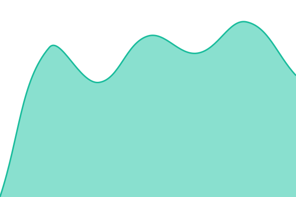
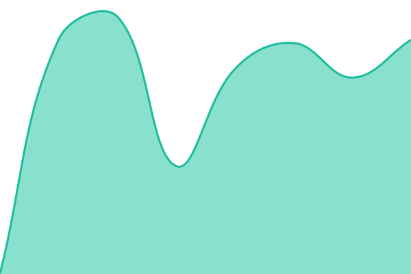
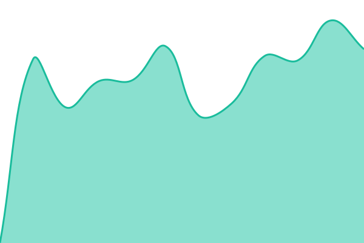

# VEKA Status

The public status page for VEKA's websites and services: **https://status.veka.gg**

It runs on [Upptime](https://upptime.js.org): GitHub Actions checks each site every 5 minutes, GitHub Issues hold the
incidents, and GitHub Pages serves the page. Nothing runs on VEKA's own servers, so the page stays up (and shows the
outage) when VEKA is down.

<!--start: status pages-->
<!-- This summary is generated by Upptime (https://github.com/upptime/upptime) -->
<!-- Do not edit this manually, your changes will be overwritten -->
<!-- prettier-ignore -->
| URL | Status | History | Response Time | Uptime |
| --- | ------ | ------- | ------------- | ------ |
|  [VEKA website](https://veka.gg/) | 🟩 Up | [veka-website.yml](https://github.com/VEKAgg/status.veka.gg/commits/HEAD/history/veka-website.yml) | 

 1057ms
     
 | 

<a href="https://status.veka.gg/history/veka-website">100.00%</a>
    

|  [FH6 India Hub](https://fh6.veka.gg/) | 🟩 Up | [fh-6-india-hub.yml](https://github.com/VEKAgg/status.veka.gg/commits/HEAD/history/fh-6-india-hub.yml) | 

 1095ms
     
 | 

<a href="https://status.veka.gg/history/fh-6-india-hub">100.00%</a>
    

|  [Interstellar Goodfellas (IGFV)](https://igfv.veka.gg/) | 🟩 Up | [interstellar-goodfellas-igfv.yml](https://github.com/VEKAgg/status.veka.gg/commits/HEAD/history/interstellar-goodfellas-igfv.yml) | 

 1092ms
     
 | 

<a href="https://status.veka.gg/history/interstellar-goodfellas-igfv">100.00%</a>
    

|  [The True Troopers (TTTR)](https://tttr.veka.gg/) | 🟩 Up | [the-true-troopers-tttr.yml](https://github.com/VEKAgg/status.veka.gg/commits/HEAD/history/the-true-troopers-tttr.yml) | 

 842ms
     
 | 

<a href="https://status.veka.gg/history/the-true-troopers-tttr">100.00%</a>
    

|  [TwistedVorteK](https://tv.veka.gg/) | 🟩 Up | [twisted-vorte-k.yml](https://github.com/VEKAgg/status.veka.gg/commits/HEAD/history/twisted-vorte-k.yml) | 

 853ms
     
 | 

<a href="https://status.veka.gg/history/twisted-vorte-k">100.00%</a>
    

|  [VorteK Academy](https://va.veka.gg/) | 🟩 Up | [vorte-k-academy.yml](https://github.com/VEKAgg/status.veka.gg/commits/HEAD/history/vorte-k-academy.yml) | 

 830ms
     
 | 

<a href="https://status.veka.gg/history/vorte-k-academy">100.00%</a>
    

|  [VEKA Cloud (Nextcloud)](https://cloud.veka.gg/status.php) | 🟩 Up | [cloud.yml](https://github.com/VEKAgg/status.veka.gg/commits/HEAD/history/cloud.yml) | 

 842ms
     
 | 

<a href="https://status.veka.gg/history/cloud">100.00%</a>
    

|  [VEKA Photos (Immich)](https://photo.veka.gg/api/server/ping) | 🟩 Up | [photos.yml](https://github.com/VEKAgg/status.veka.gg/commits/HEAD/history/photos.yml) | 

 831ms
     
 | 

<a href="https://status.veka.gg/history/photos">100.00%</a>
    

|  [VEKA Git (Forgejo)](https://git.veka.gg/api/healthz) | 🟩 Up | [git.yml](https://github.com/VEKAgg/status.veka.gg/commits/HEAD/history/git.yml) | 

 831ms
     
 | 

<a href="https://status.veka.gg/history/git">100.00%</a>
    

|  [VEKA Discord Bot](https://api.veka.gg/v1/health) | 🟩 Up | [discord-bot.yml](https://github.com/VEKAgg/status.veka.gg/commits/HEAD/history/discord-bot.yml) | 

 877ms
     
 | 

<a href="https://status.veka.gg/history/discord-bot">100.00%</a>
    

<!--end: status pages-->

## What's checked

All checks come from outside VEKA's network, the way visitors reach the sites.

| Service                        | URL checked                           |
| ------------------------------ | ------------------------------------- |
| VEKA website                   | https://veka.gg/                      |
| FH6 India Hub                  | https://fh6.veka.gg/                  |
| Interstellar Goodfellas (IGFV) | https://igfv.veka.gg/                 |
| The True Troopers (TTTR)       | https://tttr.veka.gg/                 |
| TwistedVorteK                  | https://tv.veka.gg/                   |
| VorteK Academy                 | https://va.veka.gg/                   |
| VEKA Cloud (Nextcloud)         | https://cloud.veka.gg/status.php      |
| VEKA Photos (Immich)           | https://photo.veka.gg/api/server/ping |
| VEKA Git (Forgejo)             | https://git.veka.gg/api/healthz       |

Internal pages (Grafana, Proxmox, TrueNAS) aren't listed on purpose. They're watched by the internal monitoring,
which alerts the admins on Telegram. The Discord bot and the API have no public URL yet, so they aren't checked here.

## Incidents

- **Automatic.** When a check fails, Upptime opens an issue in this repo and closes it when the site is back. Add
  comments to the issue to post updates; they show on the status page.
- **By hand** (for example planned maintenance): open an issue with the label `maintenance`. Put the start and end in
  the issue body, for example `start: 2026-10-20T20:00:00Z` and `end: 2026-10-20T22:00:00Z`.

## Changing what's checked

Edit [`.upptimerc.yml`](.upptimerc.yml) and push. Each entry under `sites:` needs a `name` and a `url`. The next run
picks it up; the status page rebuilds once a day, or right away from Actions → Static Site CI → Run workflow.

Use a health URL where the app has one (like `/status.php` for Nextcloud), not a login page.

## Setup (one time)

1. **Token.** Create a personal access token with `repo` and `workflow` access to this repo and add it under
   Settings → Secrets and variables → Actions as `GH_PAT`.
2. **Actions.** Settings → Actions → General → Workflow permissions: _Read and write_.
3. **First run.** Actions → Setup CI → Run workflow. It builds the page into the `gh-pages` branch.
4. **Pages.** Settings → Pages → Deploy from branch `gh-pages`, custom domain `status.veka.gg`, Enforce HTTPS.
5. **DNS.** Cloudflare: `CNAME status → vekagg.github.io`, **DNS only** (grey cloud).

## Files

| Path                          | What it is                                                                                  |
| ----------------------------- | ------------------------------------------------------------------------------------------- |
| `.upptimerc.yml`              | The config: which sites, how often, what the page looks like                                |
| `.github/workflows/`          | Upptime's workflows. Kept up to date by the Update Template CI workflow, so don't edit them |
| `history/`, `api/`, `graphs/` | Check results, written by the workflows                                                     |
| `assets/veka-logo.svg`        | Logo and favicon for the page                                                               |
